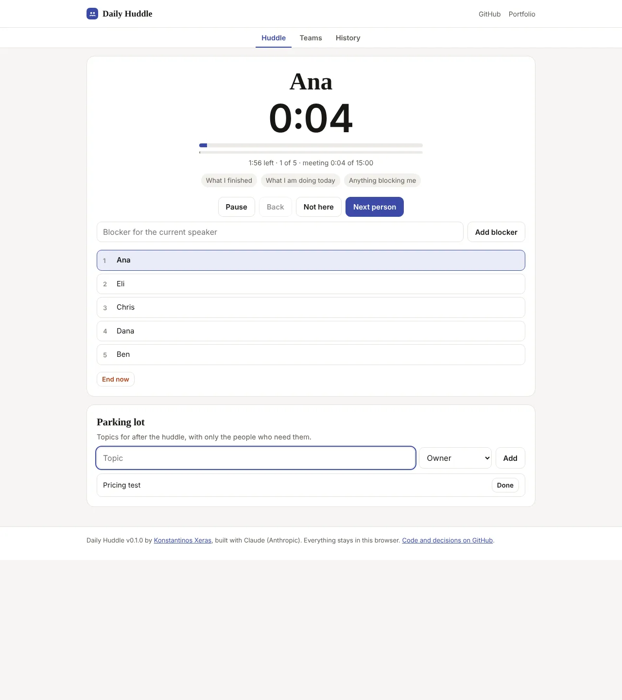

# Daily Huddle

**Run a short daily standup: a fair speaking order, a timer per person, blockers and side topics captured, and a history of how your meetings run.**

**Current version:** 0.1.0

Live app: https://kostasxeras.com/daily-huddle/



## Why this exists

Standups drift in two ways: the same person always opens, and updates turn into discussions. Most teams fix this with good intentions and a facilitator who gives up after a week. This app makes the fair version the default and keeps the evidence, so the team can see whether its standup is getting shorter.

## Who it is for

- Scrum masters, team leads and product managers who run a daily standup
- Teams that rotate the facilitator and want the same rules every day
- Remote teams that share a screen during the call

## What it does

- **Teams:** save several teams, each with its own members, minutes per person, meeting timebox, prompts and sound setting.
- **Speaking order:** fair rotation (whoever went first least often goes first), random shuffle, alphabetical or team order. Tick who is here.
- **Live huddle:** big name and timer, a bar for the person and a bar for the whole meeting, the prompts, Pause, Back, Not here, Next and End now. Optional sound and vibration when time is up. Keyboard shortcuts. Keeps the screen awake.
- **Blockers:** note a blocker against the current speaker in one line.
- **Parking lot:** topics for after the meeting, each with an owner.
- **Summary:** order, times, who was not here, blockers and parked topics, ready to paste into chat.
- **History:** number of huddles, average length, share within the timebox, share of turns over time, a chart of the last 14 huddles, who went first, and a CSV download.

## Privacy

Everything is stored in your browser's local storage. There is no account and no server of mine. Nothing is sent anywhere. Clearing your browser data deletes it.

## Decisions

- [Make fair rotation the default order](docs/decisions/0001-fair-rotation-by-default.md)
- [Show the timer, never cut people off](docs/decisions/0002-visible-timer-no-cut-off.md)
- [Keep names and history in the browser](docs/decisions/0003-history-stays-local.md)

## How I would measure success

No usage data yet. These are the measures I would track, with targets to set after a first month of use.

| Measure | Definition | Target |
|---|---|---|
| Meeting length | Median huddle length against the timebox, week over week | [x] min |
| Overruns | Share of turns over the per person time | [x]% |
| Fairness | Spread of who went first after 20 huddles | [x] |

## What I would do next

1. Shared history for teams that rotate the facilitator
2. A short daily summary posted to a chat channel, on request
3. Blocker follow-up: carry open blockers into the next huddle

## My role

I defined the problem, the users, the features and the decisions. The idea started from a small example in Ziplines' list of project ideas, which I turned into a full app with my own product choices.

## Run it yourself

It is one HTML page and one stylesheet, with no build step. Open `index.html` through any local web server, for example `python3 -m http.server`, then go to http://localhost:8000.

## Repo layout

```
index.html               The app
app.css                  Shared base styles
docs/product-brief.md    Problem, users, goals, scope
docs/case-study.md       Approach, decisions, what to measure, next steps
docs/decisions/          One record per real tradeoff
docs/screenshots/        Desktop and mobile
```
